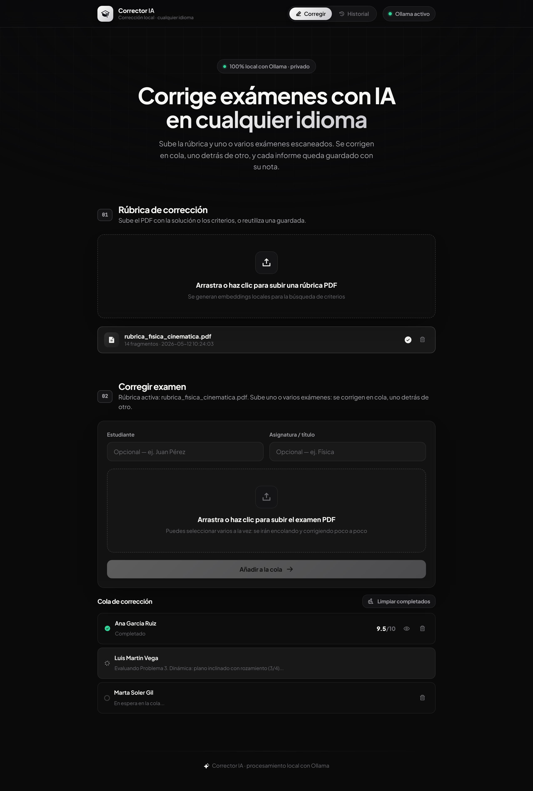

# Corrector IA

Corrector de exámenes con IA que funciona **100 % en local**. Subes la rúbrica y los
exámenes de tus alumnos en PDF, y la aplicación lee cada examen, busca los criterios
que le aplican, puntúa pregunta por pregunta y genera un informe con la nota.

Ningún dato sale de tu ordenador: todo el procesamiento (OCR, embeddings y evaluación)
se ejecuta con [Ollama](https://ollama.com) en tu propia máquina.



---

## Qué hace

- **Corrige en cualquier idioma.** El modelo detecta el idioma del examen y redacta
  las correcciones en ese mismo idioma. El detector de preguntas reconoce encabezados
  en español, inglés, francés, alemán, italiano y portugués.
- **Se apoya en tu rúbrica (RAG).** La rúbrica se trocea, se indexa con embeddings y,
  para cada pregunta, se recuperan los criterios más relevantes antes de puntuar.
- **Cola de corrección.** Suelta 30 exámenes de golpe: se encolan y se corrigen uno
  detrás de otro en segundo plano. Puedes cerrar el navegador y volver más tarde.
- **La última palabra la tienes tú.** Cada nota y cada estado (correcto / parcial /
  incorrecto) es editable a mano; la nota final se recalcula y se guarda.
- **Historial persistente.** Toda corrección queda guardada en disco, así que no hay
  que repetir el proceso (que consume GPU) para volver a consultar o descargar un informe.
- **Informe en PDF** por alumno, con el desglose por pregunta y los criterios aplicados.

---

## Requisitos

| | Mínimo | Recomendado |
|---|---|---|
| **Python** | 3.10 | 3.12 |
| **Node.js** | 18 | 20 |
| **Ollama** | Cualquier versión reciente | — |
| **GPU** | Ninguna (funciona por CPU, lento) | NVIDIA con 12 GB de VRAM o más |
| **Disco** | ~4 GB (modelo ligero, sin OCR) | ~14 GB (modelo grande + OCR) |

Probado en Windows 11 con una RTX 4070 Ti SUPER (16 GB): unos **7 segundos por pregunta**
y ~8 GB de VRAM con el modelo `gemma3:12b`.

---

## Instalación

Con [Ollama ya instalado](https://ollama.com/download), desde la raíz del proyecto:

```powershell
.\install.ps1
```

El script comprueba los requisitos, crea el entorno virtual `.venv`, instala las
dependencias de Python y del frontend, y descarga los tres modelos de Ollama.
Es idempotente: puedes relanzarlo cuando quieras.

**Opciones útiles:**

```powershell
# Equipos con menos de 12 GB de VRAM
.\install.ps1 -ModeloEvaluador gemma3:4b

# Sin OCR: ahorra ~5 GB, pero solo corrige PDFs digitales (no escaneados)
.\install.ps1 -SinOcr

# Solo dependencias, sin descargar modelos
.\install.ps1 -SoloDependencias

# Solo los modelos (p. ej. si instalaste Ollama después)
.\install.ps1 -SoloModelos
```

<details>
<summary>Instalación manual (Linux / macOS o si prefieres hacerlo a mano)</summary>

```bash
python -m venv .venv
source .venv/bin/activate          # Windows: .venv\Scripts\activate
pip install -r requirements.txt
pip install -r requirements-ocr.txt   # opcional: OCR para exámenes escaneados

cd frontend && npm install && cd ..

ollama pull gemma3:12b        # evaluador (o gemma3:4b si vas justo de VRAM)
ollama pull embeddinggemma    # embeddings para la rúbrica
ollama pull glm-ocr           # OCR (opcional)
```
</details>

---

## Puesta en marcha

Un solo comando: al levantar el frontend se arranca también el backend.

```powershell
cd frontend
npm run dev
```

Abre <http://localhost:5173>. En la esquina superior derecha verás si Ollama está
activo y si te falta algún modelo.

Los mensajes del backend salen en la misma terminal con el prefijo `[backend]`, y al
parar el servidor con `Ctrl+C` se cierra también. La API queda en
<http://localhost:8000>, con su documentación interactiva en `/docs`.

<details>
<summary>Arrancarlos por separado</summary>

Si prefieres controlar el backend aparte (para depurarlo, ver su salida limpia o
recargarlo por tu cuenta), simplemente arráncalo antes: `npm run dev` comprueba el
puerto 8000 y, si ya hay algo escuchando, no lanza un segundo proceso.

```powershell
# Terminal 1 — backend
.\.venv\Scripts\python.exe server.py

# Terminal 2 — frontend
cd frontend
npm run dev
```
</details>

---

## Prueba rápida con los ejemplos incluidos

En la carpeta [`ejemplos/`](ejemplos) tienes un caso completo de Física de 1.º de
Bachillerato para probar sin buscar material propio: un examen de **6 problemas
repartidos en 2 páginas** (cinemática, dinámica, energía y teoría), con 10 puntos en
total, y tres alumnos con niveles distintos.

| Archivo | Qué es | Nota que suele sacar |
|---|---|---|
| `rubrica_fisica_cinematica.pdf` | Rúbrica del profesor: soluciones desarrolladas y criterios de puntuación apartado por apartado | — |
| `ana_garcia.pdf` | Examen resuelto correctamente y bien razonado | 9,9 – 10 |
| `marta_soler.pdf` | Buen planteamiento con fallos puntuales (coeficiente equivocado, confunde tensión con peso, teoría incompleta) | 7 – 8 |
| `luis_martin.pdf` | Errores conceptuales de base (ignora el rozamiento, confunde MRUA con movimiento uniforme, apartados en blanco) | 2 – 4 |

Pasos:

1. En **Rúbrica de corrección**, sube `rubrica_fisica_cinematica.pdf` y espera a que
   se generen los embeddings.
2. En **Corregir examen**, selecciona **los tres exámenes a la vez** y pulsa
   *Añadir a la cola*.
3. Verás cómo se corrigen uno detrás de otro (unos 2 minutos por alumno con
   `gemma3:12b` en una GPU de gama media). Al terminar, pulsa el ojo de cada fila
   para revisar el desglose, ajustar notas si hace falta y descargar el informe PDF.

Los errores de Marta y Luis están puestos a propósito para que se vea cómo el modelo
localiza el fallo concreto y cita el criterio de la rúbrica que aplica. Las notas son
orientativas: un modelo local tiene algo de variación entre ejecuciones, y por eso
existe la corrección manual.

> El nombre del alumno se toma del nombre del archivo (`ana_garcia.pdf` → «Ana Garcia»),
> salvo que subas un único examen y escribas el nombre a mano. Nombra los PDFs con el
> nombre del alumno y te ahorras teclear.

---

## Cómo funciona

```
RÚBRICA (PDF)                          EXAMEN (PDF)
     |                                      |
 texto (PyMuPDF)                    texto (GLM-OCR o PyMuPDF)
     |                                      |
 troceado en chunks                 segmentación por preguntas
 (~500 car., solape 100)            (regex multiidioma + puntos del enunciado)
     |                                      |
 embeddings (embeddinggemma)               |
     |                                      |
   rags/*.json  <----- similitud coseno ----+   top-5 criterios por pregunta
                                            |
                                     evaluación (gemma3)
                                     salida JSON forzada por esquema
                                            |
                                   nota + informe PDF + historial
```

Detalles que importan:

- **La puntuación máxima no la decide el modelo.** Se extrae del propio enunciado con
  una expresión regular (`(2,5 puntos)`, `(3 points)`, …). Así la nota total siempre cuadra.
- **La suma tampoco la hace el modelo.** Se le pide que puntúe **cada apartado por
  separado** y es Python quien suma. Pedirle una nota global por pregunta salía mal:
  citaba el criterio correcto («0 puntos en b) y en c)») y acto seguido devolvía 0,9
  sobre 1,5. Si los máximos que propone no cuadran con el total del enunciado, se
  reescala la proporción para respetarlo, y si añade una fila que repite el total se
  descarta. El desglose se muestra en la interfaz y en el informe PDF, así que se ve
  de dónde sale cada décima.
- **El estado se deriva de la nota**, no lo elige el modelo: así la etiqueta
  (correcto / parcial / incorrecto) nunca contradice a los puntos.
- **Un solo modelo en VRAM a la vez.** El pipeline va en dos fases: primero calcula
  el RAG de *todas* las preguntas con el modelo de embeddings cargado, lo libera, y
  después evalúa con el modelo grande. Alternar modelo en cada pregunta agotaba la VRAM.
- **Salida estructurada.** Se usa el parámetro `format` de Ollama con un esquema JSON,
  en lugar de confiar en que el modelo devuelva JSON válido por su cuenta.
- **Se evitan los modelos «razonadores»** (variantes `e4b`/`e2b`, `deepseek-r1`): su
  traza de pensamiento es larga e impredecible y a menudo deja el JSON vacío.
- **Si una pregunta falla**, se marca como pendiente de revisión manual en vez de
  tumbar la corrección entera.

---

## Configuración

Variables de entorno que lee el backend (todas opcionales):

| Variable | Por defecto | Para qué sirve |
|---|---|---|
| `MODELO_GEMMA` | `gemma3:12b` | Modelo que puntúa las respuestas |
| `MODELO_EMBEDDING` | `embeddinggemma` | Modelo de embeddings de la rúbrica |
| `MODELO_OCR` | `glm-ocr:latest` | Modelo de OCR |
| `MAX_UPLOAD_MB` | `30` | Tamaño máximo por PDF subido |
| `CORS_ORIGINS` | *(vacío)* | Orígenes extra separados por comas. Cualquier puerto de `localhost` / `127.0.0.1` ya está permitido |

Ejemplo, para usar el modelo ligero:

```powershell
$env:MODELO_GEMMA = "gemma3:4b"
.\.venv\Scripts\python.exe server.py
```

Si el modelo indicado no está instalado, el backend busca automáticamente una
alternativa razonable entre los que sí tengas.

---

## Estructura del proyecto

```
.
├── server.py               API FastAPI: endpoints, cola de corrección y pipeline
├── ocr.py                  Extracción de texto (GLM-OCR con fallback a PyMuPDF)
├── rag_manager.py          Troceado, embeddings y búsqueda por similitud coseno
├── pdf_generator.py        Generación del informe PDF (ReportLab)
├── config.yaml             Configuración de GLM-OCR (apunta a Ollama)
├── install.ps1             Instalador
├── requirements.txt        Dependencias de Python
├── requirements-ocr.txt    Dependencias del OCR (opcional, arrastra torch)
│
├── frontend/               React 18 + TypeScript + Vite + Framer Motion
│   └── src/
│       ├── App.tsx             Layout, pestañas y navegación
│       ├── api.ts              Cliente de la API
│       └── components/         Rúbrica, cola, historial, resultados…
│
├── ejemplos/               Rúbrica y exámenes de muestra
├── rags/                   Rúbricas procesadas (JSON con embeddings)
├── resultados/             Historial de correcciones (JSON)
├── informes/               Informes PDF generados
└── temp/                   Subidas temporales (se limpian solas)
```

> `main.py` y `prompt.md` son restos de pruebas iniciales y no forman parte del flujo
> de la aplicación.

---

## API REST

Documentación interactiva en <http://localhost:8000/docs> con el backend arrancado.

| Método | Ruta | Descripción |
|---|---|---|
| `GET` | `/api/health` | Estado del servidor, de Ollama y de los modelos requeridos |
| `POST` | `/api/rubrica/upload` | Sube y procesa una rúbrica (streaming SSE) |
| `GET` | `/api/rubrica/list` | Lista las rúbricas guardadas |
| `POST` | `/api/rubrica/activate` | Activa una rúbrica existente |
| `DELETE` | `/api/rubrica?path=…` | Elimina una rúbrica |
| `POST` | `/api/cola` | Añade uno o varios exámenes a la cola (devuelve al instante) |
| `GET` | `/api/cola` | Estado de la cola de corrección |
| `DELETE` | `/api/cola/{id}` | Quita un examen de la cola (si aún no ha empezado) |
| `POST` | `/api/cola/limpiar` | Descarta de la vista los ya terminados |
| `GET` | `/api/historial` | Lista de correcciones guardadas |
| `GET` | `/api/historial/{id}` | Una corrección completa |
| `PUT` | `/api/historial/{id}` | Guarda notas corregidas a mano y recalcula |
| `DELETE` | `/api/historial/{id}` | Borra una corrección del historial |
| `POST` | `/api/informe/generar` | Genera y descarga el informe PDF |

La rúbrica activa se guarda en `rags/.active_rubric`, así que sobrevive a reinicios
del servidor.

---

## Solución de problemas

**«Ollama offline» en la barra superior**
Arranca la aplicación de Ollama y comprueba que responde: `curl http://localhost:11434/api/tags`.

**Ollama no arranca y su log termina en `panic: bad origin`**
Las versiones recientes de Ollama solo admiten orígenes que empiecen por `http://`,
`https://` o `*-extension://`. Si tienes definida la variable `OLLAMA_ORIGINS` con
algo como `capacitor://localhost`, el servidor revienta al arrancar. Revísala con
`echo $env:OLLAMA_ORIGINS` y deja solo orígenes válidos (o bórrala):

```powershell
[Environment]::SetEnvironmentVariable('OLLAMA_ORIGINS', 'http://localhost,http://localhost:*', 'User')
```

El log está en `%LOCALAPPDATA%\Ollama\server.log`.

**«Faltan modelos»**
Pasa el ratón por encima del indicador para ver cuáles y descárgalos con
`ollama pull <modelo>`, o relanza `.\install.ps1 -SoloModelos`.

**Se queda sin memoria de GPU**
Usa el modelo ligero: `$env:MODELO_GEMMA = "gemma3:4b"` antes de arrancar el backend.

**Detecta mal las preguntas o las junta todas**
El segmentador busca encabezados del tipo `Problema 1`, `Pregunta 2:`, `Cuestión 3`…
o listas numeradas al principio de línea. Si el examen no tiene esa estructura, cae
en un modo de emergencia (una «pregunta» por página). Numera los enunciados e indica
los puntos entre paréntesis (`(2,5 puntos)`) para obtener el mejor resultado.

**Un examen escaneado sale con el texto vacío o ilegible**
Necesitas el OCR: `pip install -r requirements-ocr.txt` y `ollama pull glm-ocr`.
Sin él solo se leen PDFs que ya contienen capa de texto.

**El frontend no conecta con el backend**
El backend acepta cualquier puerto de `localhost`. Comprueba que está escuchando en
el 8000; si lo cambias, ajusta también `API_BASE` en `frontend/src/api.ts`.

---

## Licencia

Proyecto de uso educativo. Los modelos que descarga (Gemma 3, EmbeddingGemma, GLM-OCR)
tienen cada uno su propia licencia.
